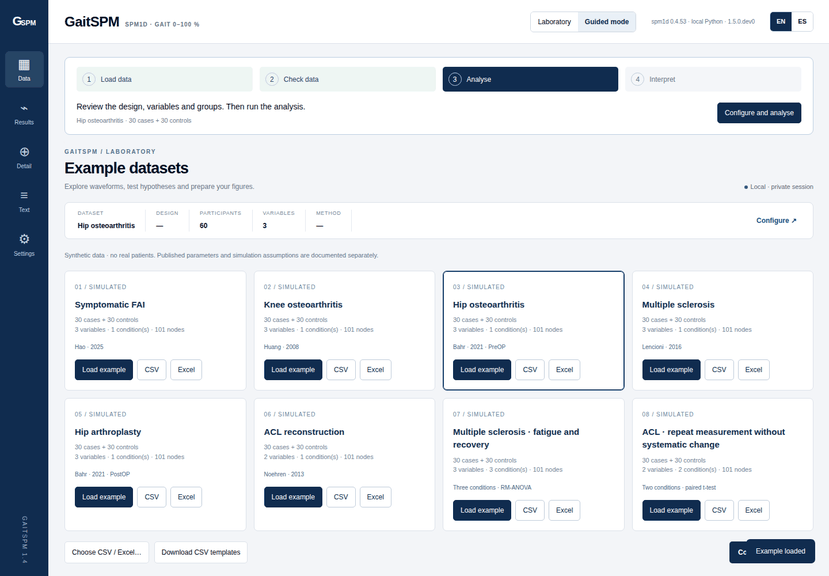
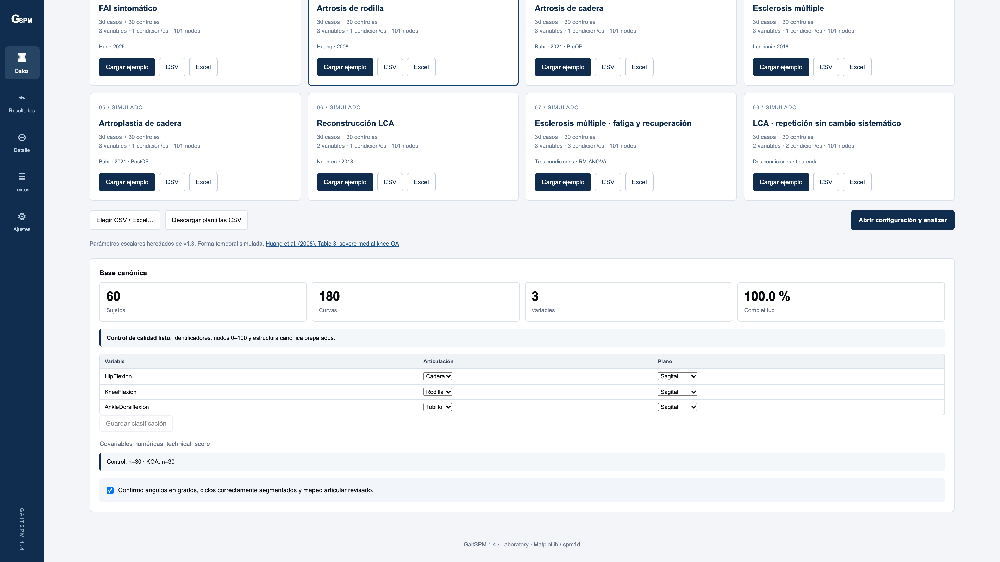
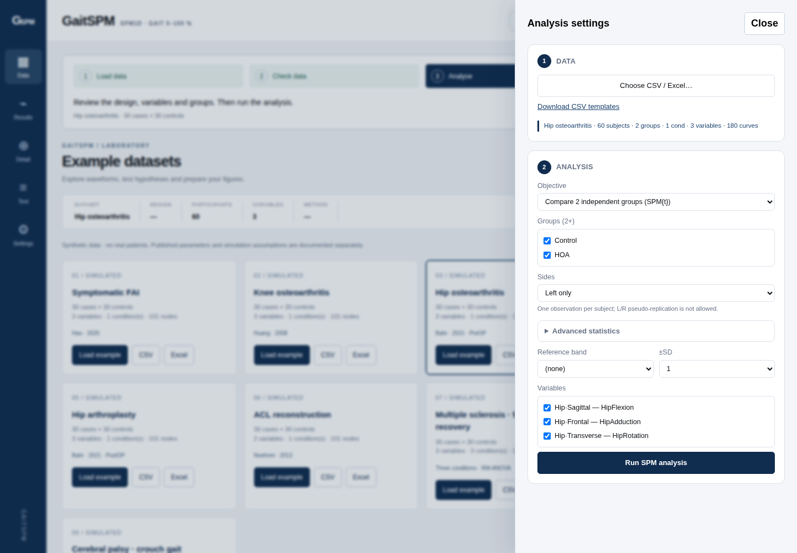
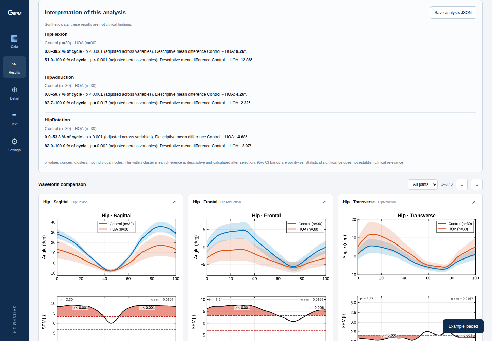
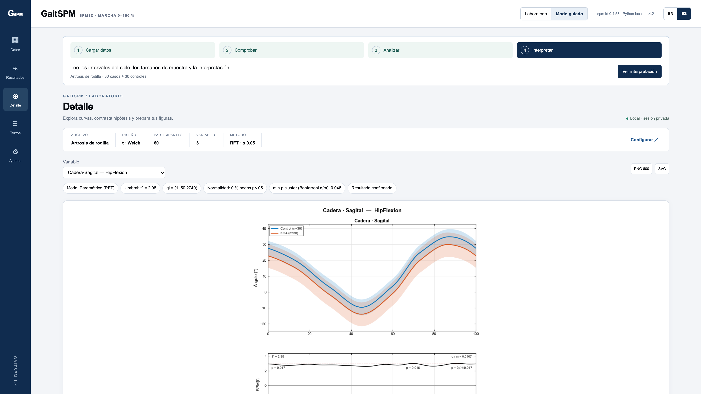
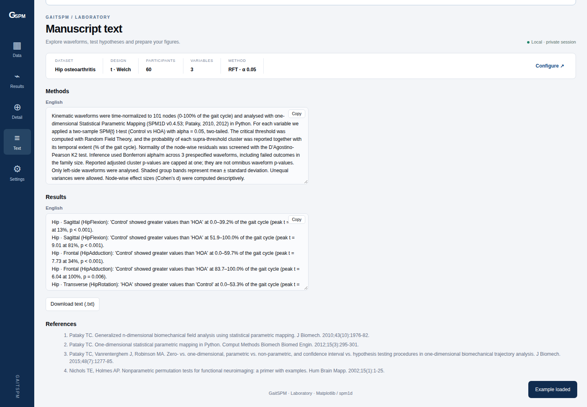
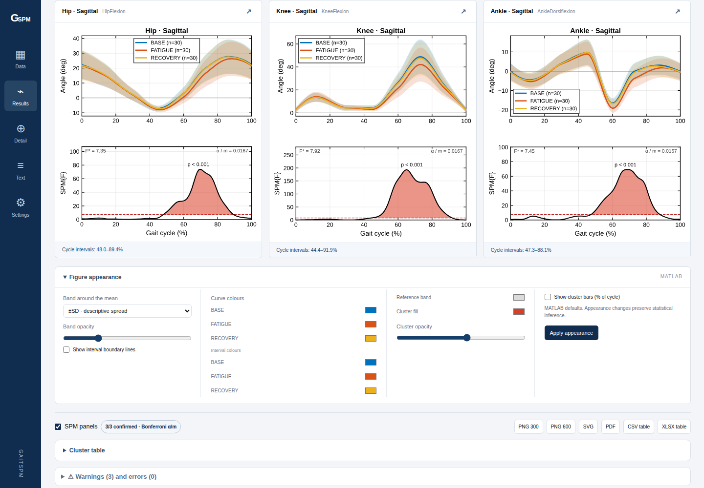

<h1 align="center">GaitSPM</h1>
<p align="center"><strong>From gait curves to SPM — without writing analysis code.</strong><br>Participant-aware analysis · MATLAB-style figures · CSV / Excel → SPM → export</p>

<p align="center">
  <a href="https://github.com/AngelGF8/GaitSPM/actions/workflows/tests.yml"></a>
  <a href="https://github.com/AngelGF8/GaitSPM/actions/workflows/pages.yml"></a>
  <a href="LICENSE"></a>
  <a href="requirements.txt"></a>
  <a href="https://spm1d.org/"></a>
  <a href="CHANGELOG.md"></a>
</p>

<p align="center">
  <a href="https://angelgf8.github.io/GaitSPM/app/"></a>
</p>
<p align="center"><a href="https://angelgf8.github.io/GaitSPM/">Documentation</a> · <a href="LEEME_PRIMERO.md">Guía en español</a> · <a href="#start-on-your-computer">Run locally</a> · <a href="ROADMAP.md">Roadmap</a> · <a href="CONTRIBUTING.md">Contribute</a></p>

## See the workflow

<p align="center"><a href="https://angelgf8.github.io/GaitSPM/app/"></a></p>
<p align="center"><strong>1. Load curves → 2. Check participants → 3. Choose a design → 4. Explore and export</strong></p>

The animation uses real interface screenshots of synthetic teaching examples. Browser mode downloads its scientific runtime on first use and processes uploaded data in your browser. Native Python remains the reference environment for the automated numerical checks.

[Statistical designs](docs/statistics.md) · [Software validation](docs/validation-guide.md) · [Changelog](CHANGELOG.md) · Last released citation: **1.4.2**

## Unreleased statistical extensions

The local development version adds **two-group ANCOVA**, **numeric-predictor GLM t contrasts**, **balanced two-way independent ANOVA**, and **mixed group × repeated-condition ANOVA** in Laboratory and optional Streamlit modes. New designs require parametric inference and equal variance. Mixed ANOVA assumes sphericity and uses upstream approximate residual inference with one averaged response per cell. Factorial inference always protects all three effects with Bonferroni; across-variable correction is additional. See [model definitions and limits](docs/statistics.md).

## Reproducible software checks

The software test suite compares GaitSPM with direct spm1d calls using deterministic synthetic inputs. It covers statistic fields, critical thresholds, cluster endpoints and p-values, as well as invalid models, missing data and factorial corrections.

```sh
python tests/test_spm1d_validation.py
```

See the [validation methodology](docs/validation-guide.md). Research manuscripts and their results are maintained separately and are not part of this software update.

## Choose a workflow

| Aspect | GaitSPM | spm1d by code | Commercial software |
|---|---|---|---|
| Installation | Browser via GitHub Pages or native Python launcher | Python or MATLAB environment | Product dependent |
| Code needed for routine analysis | Graphical controls | Analysis scripts | Product dependent |
| Privacy | Native local or browser processing; hosted Streamlit would be remote | Depends on where scripts run | Deployment and vendor dependent |
| Statistical designs | Guided subset plus adjusted/factorial models with stated limits | Broader programmable upstream API | Check the specific product and version |
| Price / licence | No licence fee; GPL v3 | Open-source upstream; MATLAB runtime has separate licensing | Vendor dependent; no universal price claim |

## Interface gallery

Six views of the MATLAB-style interface. Click a screenshot to inspect it at full size. All examples shown are synthetic.

<table>
  <tr>
    <td width="50%" align="center"><strong>01 · Import and participant mapping</strong><br><br><a href="capturas/03_control_calidad_mapeo.png"></a></td>
    <td width="50%" align="center"><strong>02 · Configure your analysis</strong><br><br><a href="capturas/04_configuracion_analisis.png"></a></td>
  </tr>
  <tr>
    <td width="50%" align="center"><strong>03 · Curves and SPM fields</strong><br><br><a href="capturas/06_resultados_figura_spm.png"></a></td>
    <td width="50%" align="center"><strong>04 · Inspect a variable</strong><br><br><a href="capturas/07_detalle_variable.png"></a></td>
  </tr>
  <tr>
    <td width="50%" align="center"><strong>05 · Methods and results text</strong><br><br><a href="capturas/08_textos_metodos_resultados.png"></a></td>
    <td width="50%" align="center"><strong>06 · Repeated-measures ANOVA</strong><br><br><a href="capturas/12_anova_medidas_repetidas.png"></a></td>
  </tr>
</table>

Local kinematic gait analysis with **spm1d 0.4.53**, a **Guided mode** and a **Laboratory mode**. English is the default interface language; use **ES** to switch to Spanish. Your explicit language choice is remembered in the browser.

[Guía en español](LEEME_PRIMERO.md) · [Automated checks](https://github.com/AngelGF8/GaitSPM/actions)

## Start on your computer

For a stable release, prefer its `GaitSPM_v*.zip` application asset. GitHub’s automatic source archive also includes developer tools and tests.

1. Download the repository using **Code → Download ZIP**, or clone it. Extract the complete folder before running.
2. Install **Python 3.12**, the version used by the automated checks.
3. Run the appropriate launcher:
   - **Windows:** double-click `Iniciar_GaitSPM.bat`, or run `py -3 launch.py`.
   - **macOS:** open `Iniciar_GaitSPM.command`. If it does not open, run `bash Iniciar_GaitSPM.command` from Terminal in the project folder.
   - **Linux:** run `bash iniciar_gaitspm.sh`, or `python3 launch.py`.
4. First-time setup creates a local `.venv` and installs the dependencies. Internet access is required for this installation.
5. The application opens at **http://127.0.0.1:4173**. Keep the terminal open; press **Ctrl+C** to stop. If the port is occupied, add `--port 4175` to the Python command.

Analysis runs on your computer. After dependencies are installed, native local mode does not need internet access. There is no remote analysis service or application account. Uploaded files are stored temporarily on the computer and cleaned up when the server shuts down normally. The application is not a clinical records system.

## First analysis

In **Guided mode**, choose **Load example**, inspect the participant counts and joint mapping, then select **Configure and analyse**. Review the design, groups, variables and units before running.

To try file import, download a card's CSV or Excel file and upload it. The same files are included in `datasets/synthetic/`. Each workbook contains `Guide`, `Metrics`, `Curves_Wide` and `Participants`; the importer selects `Curves_Wide`. Review the detected columns and select **Apply mapping**.

Unmodified examples are recognised and offered their predefined analysis settings. Edited or external data require manual configuration. **Nodes 0–100 represent an already segmented gait cycle.** GaitSPM does not detect gait events or convert raw sensor signals into joint angles.

The report shows mean curves, variability bands, SPM fields, cluster intervals, analysed sample sizes and an interpretation based on the current results. Figures, tables and report text use the selected language. Methods and Results text can be copied or exported; the analysis configuration can be saved as JSON.

## Eight examples, six clinical contexts

| Example | Context | Simulated participants | Default analysis |
|---|---|---:|---|
| 01 | Femoroacetabular impingement syndrome (FAIS) | 30 cases + 30 controls | Independent groups, Welch |
| 02 | Knee osteoarthritis | 30 + 30 | Independent groups, Welch |
| 03 | Hip osteoarthritis | 30 + 30 | Independent groups, Welch |
| 04 | Multiple sclerosis | 30 + 30 | Independent groups, Welch |
| 05 | Hip arthroplasty | 30 + 30 | Independent groups, Welch |
| 06 | ACL reconstruction | 30 + 30 | Independent groups, Welch |
| 07 | MS: hypothetical fatigue and recovery | 30 + 30, three repeated conditions | Repeated-measures ANOVA in the 30 cases |
| 08 | ACL: technical retest without a systematic shift | 30 + 30, two repeated conditions | Paired t-test in the 30 cases |

These are **synthetic data**, not real patient records. Every example contains 60 unique participant IDs; there are 480 distinct simulated participants across the eight examples. Repeated conditions retain the same IDs and do not increase the sample size.

Only joint angles in degrees are included: no forces, moments or EMG. The random `technical_score` covariate has no clinical meaning. The first six examples retain documented scalar anchors inherited from version 1.3, while their waveform shapes are simulated. Examples 07–08 are hypothetical teaching scenarios. Examples 03 and 05 are independent datasets and must not be paired as a surgical follow-up.

Source attribution and simulation assumptions are included with each dataset. Further guidance is available in the Spanish [example guide](docs/GUIA_EJEMPLOS.md).

## Supported input and validation

- Wide CSV/Excel: metadata plus `Variable_0` through `Variable_100` columns.
- Long format: subject, variable, node and value, with optional group, condition, side and trial columns.
- Transposed format: 0–100 nodes in rows and participant/variable metadata encoded in column names.
- Semicolon-delimited CSV with decimal commas and quoted delimiters.
- Participant IDs such as `001`, `1` and `NA` remain distinct.
- Duplicate headers, invalid identity mappings and incomplete curves are checked.
- Failed uploads or invalid analysis settings invalidate previous results.

Each participant contributes one observation for the selected design. Repeated trials and left/right measurements must not be treated as independent participants.

## Independent external CSV test

The repository includes a public **MovementRx** reference file containing **20 real kinematic curves with 101 nodes**. Its original bytes, attribution, licence and adaptation script are preserved under [tests/fixtures/movementrx](tests/fixtures/movementrx).

The original CSV has no participant IDs and is rejected accordingly. The documented adaptation adds IDs and metadata and renames node columns **without changing any angle value**. Arbitrary labels `TestA` and `TestB` divide the rows into 10 + 10 only to exercise the software; they are not clinical groups.

The real HTTP upload, mapping, Welch analysis and CSV/XLSX/PNG/SVG/PDF exports were tested. The Welch statistic agreed with SciPy to a maximum absolute difference of approximately 1.25 × 10⁻¹⁴. This software test is not a clinical comparison.

## Statistical interpretation

SPM1D analyses continuous fields. Cluster p-values are not independent pointwise tests. Across-variable Bonferroni correction is additional to inference over the temporal field.

A nonsignificant result does not establish equivalence or absence of an effect. The displayed 95% confidence bands are pointwise. Mean differences within selected clusters are descriptive. Statistical significance alone does not establish clinical relevance.

Normality checks and the exploratory automatic mode do not certify model assumptions. Label permutations are not a Welch alternative for unequal variances. Repeated-measures ANOVA depends on its sphericity assumptions; spm1d does not implement a nonsphericity correction for this design. Use post hoc comparisons to identify pairs after an omnibus test.

Refer to the official [spm1d statistics documentation](https://spm1d.org/doc/Stats1D/) and [ANOVA notes](https://spm1d.org/doc/Stats1D/anova.html). This is a technical software review, not clinical validation or certification.

## Development and verification

Edit `app/gaitspm_app.py` for engine changes. Run `python app/sync_html_engine.py` to regenerate the native engine and self-contained HTML. Interface sources are under `app/web/`; `app/serve.py` implements the local HTTP server.

Version 1.4.2 uses explicit UTF-8 for source text and adds a launcher test. GitHub Actions checks **Linux, Windows and macOS with Python 3.12**, including a fresh launcher-created virtual environment, HTTP startup, the statistical tests, the external CSV and eight offline DOM workflows. Check the [actual workflow results](https://github.com/AngelGF8/GaitSPM/actions) for the commit you use.

**Remaining limits:** automated HTTP and DOM tests do not verify visual rendering, the browser file picker, mobile layout or desktop double-click behaviour. The optional Streamlit interface and direct-file Pyodide fallback are not validated by this workflow. Use the native Python launcher.

See [test instructions](tests/README.md), [release and hosting guidance](docs/publication.md), and the [changelog](CHANGELOG.md). Historical audit files remain available in Git history.

Author: **Ángel González de la Flor**. Licensed under **GPL v3**; see [LICENSE](LICENSE) and [third-party notices](THIRD_PARTY_NOTICES.md).
